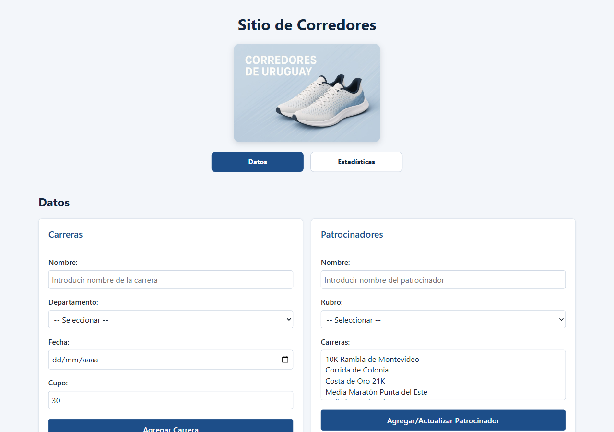
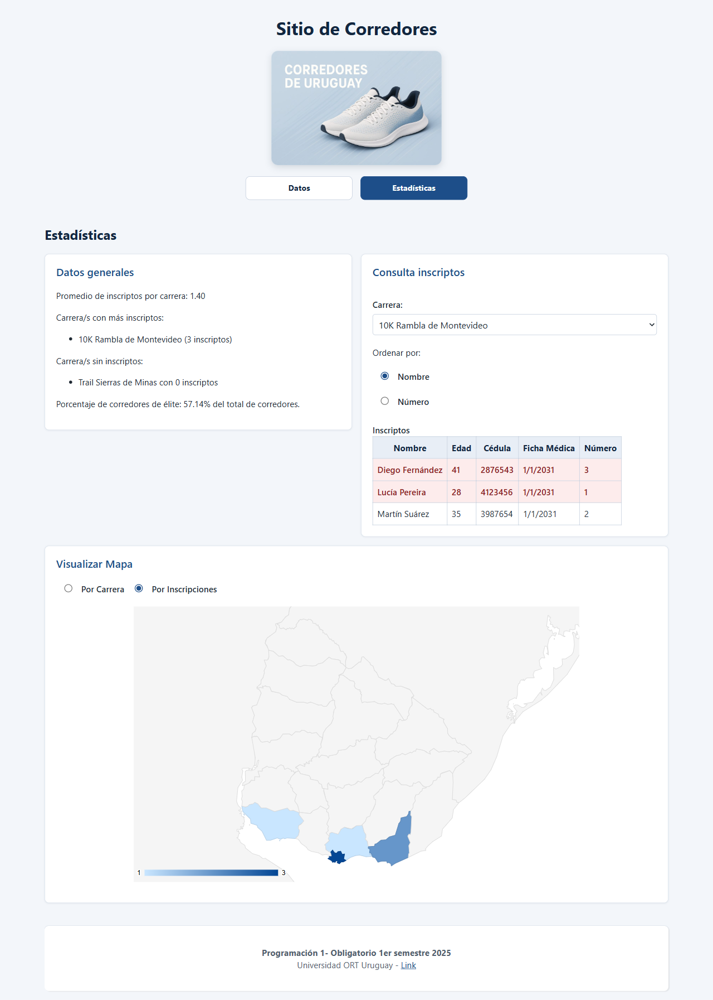
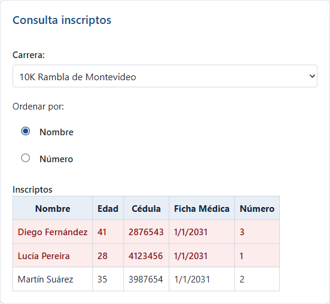
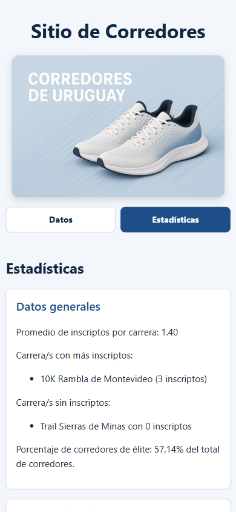
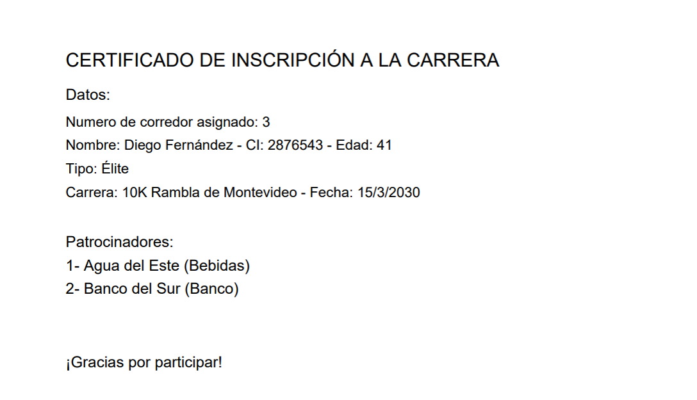

# Corredores de Uruguay

Aplicación web para organizar carreras de calle en Uruguay: carreras, patrocinadores, corredores e
inscripciones, con estadísticas y un mapa del país que muestra cuántas carreras o inscripciones hay en cada
departamento.

> Proyecto académico: obligatorio de **Programación 1**, Licenciatura en Sistemas, Universidad ORT Uruguay
> (1er semestre de 2025).

**Probala en línea:** https://pablorodriguezsouza.github.io/corredores-uruguay/

## Qué hace

- **Carreras:** nombre, departamento, fecha y cupo (entre 1 y 1000). No se repiten nombres.
- **Patrocinadores:** nombre, rubro y las carreras que patrocinan. Si el nombre ya existe, se actualizan su
  rubro y sus carreras.
- **Corredores:** nombre, edad, cédula, vencimiento de la ficha médica y tipo (élite o común). Se valida que:
  - la cédula tenga entre 6 y 8 dígitos y no esté repetida;
  - el corredor sea mayor de edad;
  - la ficha médica no esté vencida.
- **Inscripciones:** se rechazan si el corredor ya está inscripto, si su ficha médica vence antes de la carrera o
  si no queda cupo. Cada inscripto recibe un número y se descarga un **certificado en PDF** con sus datos y los
  patrocinadores de la carrera.
- **Estadísticas:**
  - promedio de inscriptos por carrera, carreras con más inscriptos y sin inscriptos, y porcentaje de élite;
  - lista de inscriptos de una carrera, ordenada por nombre o por número (los de élite resaltados);
  - mapa de Uruguay coloreado por cantidad de carreras o de inscripciones en cada departamento.

Los datos viven mientras la página está abierta: no se guardan al recargarla.

## Capturas

| | |
|---|---|
|  |  |
|  |  |

## Cómo está hecho

- **HTML5, CSS3 y JavaScript** sin frameworks ni herramientas de compilación.
- `js/clases.js`: las clases del dominio (`Carrera`, `Patrocinadores`, `Corredor`, `Inscripcion`) y `Sistema`,
  que guarda los datos y tiene las validaciones y los cálculos.
- `js/function.js`: los eventos de la página, los formularios, los combos, la tabla y el certificado.
- `js/mapa.js`: el mapa por departamento con [Google Charts (GeoChart)](https://developers.google.com/chart/interactive/docs/gallery/geochart).
- El certificado se genera con [jsPDF](https://github.com/parallax/jsPDF).

Las dos librerías se cargan desde internet, así que el mapa y el certificado necesitan conexión.

## Cómo ejecutarlo

No necesita instalación: abrí `index.html` en el navegador. También se puede usar una extensión como
Live Server de VS Code.
